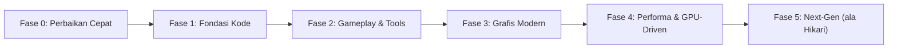

# Roadmap Rizeallday Engine v2

> [!WARNING]
> **Diarsipkan (2026-10-28).** Roadmap aktif ada di [`ROADMAP.md`](ROADMAP.md). Dokumen ini disimpan hanya sebagai riwayat;
> item yang sudah selesai atau digabung tercatat di sana.

Roadmap ini disusun dari kondisi kode engine saat ini (DirectX 12, Editor Suite ImGui, C++ Script Hot-Reload, Shadow Map, FBX Animation, Frustum Culling, Audio Media Foundation). Urutannya dari yang **paling berdampak & paling murah** sampai yang **paling ambisius** (arah Hikari Engine).

Kesulitan: ⭐ Mudah · ⭐⭐ Sedang · ⭐⭐⭐ Sulit · ⭐⭐⭐⭐ Sangat sulit

---

## Fase 0 — Perbaikan Cepat (1–3 hari)

Hal kecil yang saya temukan saat mengerjakan engine dan sebaiknya dibereskan dulu.

| # | Tugas | Kenapa | Kesulitan |
|---|---|---|---|
| 0.1 | Samakan nama file konfigurasi export | `EditorApp.cpp` mengecek `BuildConfig.json`, tapi exporter menulis `game_build.cfg` → game hasil export tetap menampilkan splash dulu | ⭐ |
| 0.2 | Definisikan konstanta key (`KEY_W`, `KEY_SPACE`, …) di `ScriptAPI.h` | Script tidak perlu lagi `#include <dinput.h>` | ⭐ |
| 0.3 | Ekspos `velocity`, `isGrounded`, `GetMousePosition()`, gamepad ke `ScriptBase` | Script movement/kamera butuh ini | ⭐ |
| 0.4 | Bereskan warning C26495 (`NodeData::transform` tidak diinisialisasi) di `Model.h` | Menjaga 0 warning di analisis kode | ⭐ |
| 0.5 | Badge `[AUDIO]` di Project browser untuk `.m4a`/`.wma` | Saat ini hanya `.wav/.mp3/.ogg` | ⭐ |

---

## Fase 1 — Fondasi Kode (1–3 minggu)

Supaya engine tetap bisa dikembangkan tanpa makin sulit dirawat.

| # | Tugas | Kenapa | Kesulitan |
|---|---|---|---|
| 1.1 | **Pecah `EditorSuite.cpp` (~8000 baris)** menjadi `HierarchyPanel`, `InspectorPanel`, `ViewportPanel`, `ProjectPanel`, `SceneSerializer`, `PlayModeController`, `ScriptBuildService` | File monolit memperlambat compile & rawan bug | ⭐⭐ |
| 1.2 | Ganti parser JSON manual dengan **nlohmann/json** (atau RapidJSON) | Parser `find("\"key\": ")` rapuh terhadap spasi/escape string | ⭐⭐ |
| 1.3 | **Transform hierarki** (parent → child world matrix) | `parentId` sudah ada, tapi transform anak belum mengikuti parent | ⭐⭐ |
| 1.4 | Ubah `GameObject` jadi **Component-based** (`std::vector<std::unique_ptr<Component>>`) atau ECS ringan (EnTT) | Struct `GameObject` sekarang memuat semua field semua komponen | ⭐⭐⭐ |
| 1.5 | **Asset Database + GUID** (`.meta` file per aset) | Referensi aset tidak putus saat file di-rename/dipindah | ⭐⭐ |
| 1.6 | Undo/Redo berbasis **Command Pattern** | Saat ini tiap undo menyerialisasi seluruh scene (lambat di scene besar) | ⭐⭐ |
| 1.7 | Unit test dasar (math, serializer) + CI GitHub Actions menjalankan test | Mencegah regresi | ⭐⭐ |

---

## Fase 2 — Gameplay & Tools (1–2 bulan)

Agar engine benar-benar bisa dipakai membuat game seperti proyek setengah jadi Anda sebelumnya.

| # | Tugas | Detail | Kesulitan |
|---|---|---|---|
| 2.1 | **Prefab system** | Simpan GameObject + komponen sebagai `.prefab.json`, bisa di-instantiate dari script | ⭐⭐ |
| 2.2 | **In-game UI (Canvas)** | Tipe `Canvas` sudah ada tapi kosong → Image, Text (font atlas / DirectWrite), Button, anchor layout; berjalan di Release tanpa ImGui | ⭐⭐⭐ |
| 2.3 | **Physics lanjutan** | OBB/rotated collider, raycast, layer matrix; atau integrasi **Jolt Physics** | ⭐⭐⭐ |
| 2.4 | **Animator State Machine** | State Idle/Walk/Run + transisi dengan blend (crossfade) & parameter dari script | ⭐⭐⭐ |
| 2.5 | **Audio 3D & Mixer** | X3DAudio (posisi & jarak), grup BGM/SE, fade in/out | ⭐⭐ |
| 2.6 | **Scene switching dari script** | `LoadScene("Stage2")` untuk alur Title → Game → Result | ⭐ |
| 2.7 | **Save/Load data game** | API untuk menyimpan progres pemain | ⭐ |
| 2.8 | **Gizmo lebih baik** | Integrasi ImGuizmo (rotate ring, snap, local/world space) | ⭐⭐ |
| 2.9 | **Exporter mandiri** | Export memakai `Release` runtime (bukan copy exe editor) + pengemasan aset (`.pak`) | ⭐⭐ |

---

## Fase 3 — Grafis Modern (2–3 bulan)

Peningkatan visual terbesar per usaha.

| # | Tugas | Detail | Kesulitan |
|---|---|---|---|
| 3.1 | **PBR (Metallic/Roughness)** | Cook-Torrance BRDF, texture albedo/normal/ORM, material dari FBX/glTF | ⭐⭐ |
| 3.2 | **Image-Based Lighting** | Irradiance map + prefiltered specular + BRDF LUT dari skybox | ⭐⭐⭐ |
| 3.3 | **HDR + Tonemapping** | Render ke `R16G16B16A16_FLOAT`, tonemap ACES, exposure | ⭐⭐ |
| 3.4 | **Post-processing stack** | Bloom, Vignette, Color Grading (LUT), FXAA/TAA | ⭐⭐ |
| 3.5 | **Cascaded Shadow Maps + PCF** | Bayangan tajam dekat & jauh, bayangan lembut | ⭐⭐⭐ |
| 3.6 | **Shadow untuk Point/Spot light** | Cubemap shadow / spot shadow atlas | ⭐⭐⭐ |
| 3.7 | **SSAO** | Ambient occlusion layar | ⭐⭐ |
| 3.8 | **Render Graph sederhana** | Mendeklarasikan pass & resource, barrier otomatis | ⭐⭐⭐ |

---

## Fase 4 — Performa & GPU-Driven (2–4 bulan)

| # | Tugas | Detail | Kesulitan |
|---|---|---|---|
| 4.1 | **Instancing** | Satu draw call untuk banyak objek dengan mesh sama (cocok untuk Tetris/mapchip) | ⭐⭐ |
| 4.2 | **Ring buffer / linear allocator konstanta per frame** | Mengganti satu upload buffer per objek | ⭐⭐ |
| 4.3 | **Multithreaded command list recording** | Job system (task graph) untuk update & record | ⭐⭐⭐ |
| 4.4 | **Bindless resources (SM 6.6)** | `ResourceDescriptorHeap[index]` di shader | ⭐⭐⭐ |
| 4.5 | **GPU Frustum Culling + ExecuteIndirect** | Culling pindah dari CPU ke compute shader | ⭐⭐⭐ |
| 4.6 | **Hi-Z Occlusion Culling** | Objek tertutup tidak digambar | ⭐⭐⭐⭐ |
| 4.7 | **Profiler** | GPU timestamp query + CPU timer, tampil di editor (atau integrasi Tracy) | ⭐⭐ |

---

## Fase 5 — Next-Gen (inspirasi Hikari Engine)

| # | Tugas | Detail | Kesulitan |
|---|---|---|---|
| 5.1 | **Mesh Shader / Meshlets** | Amplification + Mesh shader, meshlet culling | ⭐⭐⭐⭐ |
| 5.2 | **DXR Ray Tracing** | Ray-traced shadows/AO/reflections | ⭐⭐⭐⭐ |
| 5.3 | **Volumetric Fog (Froxel)** | Kabut & light shaft | ⭐⭐⭐⭐ |
| 5.4 | **Asset cooking pipeline** | Konversi FBX/PNG ke format biner siap-GPU (BC7, meshlet) di background | ⭐⭐⭐ |
| 5.5 | **AI/MCP Editor Bridge** | Server MCP agar AI agent bisa membaca/mengedit scene editor secara live | ⭐⭐⭐ |

---

## Rekomendasi urutan

> [!TIP]
> Untuk tugas sekolah dan portofolio, urutan dengan hasil paling terlihat adalah: **Fase 0 → 1.1 → 1.3 → 2.1 → 2.2 → 3.1 → 3.3 → 3.4 → 3.5**. Kombinasi PBR + HDR + Bloom + CSM akan membuat tampilan engine langsung terasa "modern".

> [!IMPORTANT]
> Kerjakan **1.1 (memecah `EditorSuite.cpp`)** sebelum menambah fitur besar. Hampir semua fitur di Fase 2–3 menyentuh file itu, jadi memecahnya dulu akan menghemat banyak waktu.
